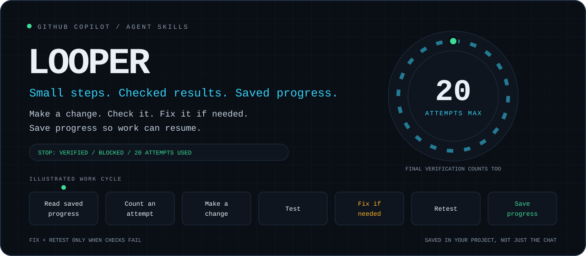

# 🔁 Looper



Looper helps AI coding agents complete complex tasks while keeping track of progress and checking results before declaring success.

Built on the open Agent Skills standard, Looper breaks work into manageable steps, saves progress across interruptions, limits execution to 20 attempts, records test evidence, and requires final verification before reporting completion.

[](https://github.com/DUBSOpenHub/looper/actions/workflows/validate.yml)
[](LICENSE)
[](SECURITY.md)


> ### ⚡ Install
>
> ```bash
> curl -fsSL https://github.com/DUBSOpenHub/looper/releases/download/v1.1.0/quickstart.sh | bash
> ```
>
> The installer downloads the specific v1.1.0 release and checks its file fingerprint against `SHA256SUMS` before installing anything. See [Verify the Download](#-verify-the-download).
>
> Then open the [GitHub Copilot CLI](https://docs.github.com/copilot/concepts/agents/about-copilot-cli) in any project and say: `looper`
>
> **Using another AI agent?** Install with the [GitHub CLI](https://cli.github.com/) instead:
>
> ```bash
> gh skill install DUBSOpenHub/looper looper@v1.1.0 --agent claude-code --scope user
> ```
>
> Swap `claude-code` for the agent you use; `gh skill install --help` lists the supported `--agent` values. See [Works With](#-works-with).
>
> *Requires Bash, a writable project folder, and an AI agent that supports [Agent Skills](https://agentskills.io/specification). macOS, Linux, or WSL. GitHub Copilot also needs an active [GitHub Copilot subscription](https://github.com/features/copilot/plans).*

---

## 🤔 What Is This?

Looper is a skill in the open [Agent Skills](https://agentskills.io/specification) format, built for GitHub Copilot. It breaks your request into small steps and defines checks for what “done” means. It works toward **verified completion**, rather than stopping after writing a plan or passing only some tests:

**Read saved progress → count an attempt → make a change → test → fix if needed → retest → save progress.**

Fixing and retesting happen only when checks fail. Each work attempt allows one round of fixes; if the checks still fail, another attempt is needed.

### What do “pass” and “durable state” mean?

A **pass** is one recorded attempt at a small step, or a separate final verification attempt. The limit is **20 attempts total**, not 20 steps or 20 minutes. Failed and interrupted attempts count too. Looper can finish earlier, but reaching the limit does not mean the work succeeded.

**Durable state** means progress is saved in files, not just in the chat. Looper records the goal, checks, completed steps, results, remaining work, and attempts used in your project folder. After an interruption or context reset, the next active agent session reads those records and compares them with the current files before resuming. It does not start over or reset the attempt count.

### 💬 The Problem

Long AI tasks can lose their place, claim success before everything is checked, or keep trying the same broken fix. Looper saves progress, records check results, and limits retries to help prevent those problems.

### ⚡ What Makes It Different

- 🔢 **At most 20 recorded attempts.** The helper records each attempt in a numbered folder, rather than relying on chat memory. The limit cannot be raised or reset.
- 💾 **Progress saved in your project.** The goal, checks, step plan, progress, and results are stored in `.ralph-loop/`, or `.ralph-loop-NAME/` for an independent named loop.
- ✅ **Define what “done” means.** Each requirement gets a check and an expected result. These requirements are called acceptance criteria and labeled `AC01`, `AC02`, and so on. The helper prevents reducing their count; the skill tells the agent not to remove or weaken them just to make checks pass.
- 🧾 **Keep proof of the checks.** A Bash script called the helper records each check's command, output, and success or failure. Its `close passed` and `verdict` commands refuse success without passing records. The agent still needs to choose checks that test the actual request.
- 🔧 **One round of fixes per work attempt.** If checks fail, the agent can make one round of fixes and check again. Each check can run at most three times in the initial testing phase and three times in the retesting phase. The helper enforces both limits.
- 🧪 **Check everything before calling it done.** A separate final attempt runs all required checks without changing the work. It compares file fingerprints before and after to confirm the work stayed unchanged.
- 🗂️ **Track separate goals by name.** One project can hold several independent tasks, each with its own saved progress and attempt limit.
- 🛟 **Say why work stopped.** Looper reports whether everything was verified, a blocker prevented progress, or all 20 attempts were used. Running out of attempts is not success.

## 🚀 Usage

In GitHub Copilot, or any other agent that has Looper installed, from your project folder:

```text
looper
looper add a --dry-run flag to the deploy script and prove it works
looper resume
looper as docs: refresh the README for the new CLI flags
looper resume docs
looper list
```

Looper reads your project instructions and existing changes, saves the checks for completion and a step plan to `.ralph-loop/state.md`, then works one attempt at a time until everything is verified, it is blocked, or all 20 attempts are used.

Use a name (`looper as NAME: …`) only for a separate, independent goal. Its progress is saved in `.ralph-loop-NAME/`. Tasks that edit the same files should run one after another, or in separate Git worktrees (separate working folders for the repository). Giving the same goal a new name does not give it another 20 attempts.

## 🔌 Works With

Looper is built for GitHub Copilot and uses the open [Agent Skills](https://agentskills.io/specification) format. Other agents that support that format can load it too. The agent must be able to read and edit files and run shell commands.

- **GitHub Copilot.** The GitHub Copilot CLI, the GitHub Copilot app, the GitHub Copilot cloud agent, and agent mode in VS Code, Visual Studio, and JetBrains IDEs [support Agent Skills](https://docs.github.com/en/copilot/concepts/customizations/agent-skills). Editor support depends on your version, and each app reads skills from its own locations. The one-line installer above installs the skill for the GitHub Copilot CLI.
- **Other AI agents.** [`gh skill`](https://cli.github.com/manual/gh_skill) can install skills for Claude Code, Cursor, Codex, Gemini CLI, and many more, using the `--agent` flag shown above. `gh skill` is in preview, so its flags may change.
- **Anything else.** Point your agent at [`skills/looper/SKILL.md`](skills/looper/SKILL.md) and ask it to follow the instructions.

> **What has been tested.** v1.1.0 has 37 helper tests and 8 installer/release-build tests. One complete task also passed through the GitHub Copilot CLI on macOS, using 2 attempts and 11 independent checks. Other supported agents and interfaces have not had the same full-task testing. See [the validation report and its limitations](docs/VALIDATION.md).

## 🗂️ Saved Progress Files

These files hold the saved progress. The `passes` folder records each attempt and its check results; previous attempt records are not rewritten.

```text
.ralph-loop/             # or .ralph-loop-NAME/ for a named loop
  format                 # identifies the saved-record format
  criteria               # number of acceptance criteria; can only grow
  state.md               # goal, checks, step plan, latest results, next action
  progress.md            # running history of decisions, failures, saved progress
  passes/01..20/
    reservation          # attempt type, selected step, start time
    runs/001..           # check commands, working folder, output, results
    repair               # records that this attempt used its one round of fixes
    result               # passed / failed / blocked / interrupted
```

> The skill is called `looper`, but its saved-progress folder still uses `.ralph-loop/` and the format marker `ralph-loop-pass-ledger-v1`. Keeping those names lets tasks started before the rename resume.

## 🛠️ How Attempts Are Recorded

**You do not need to run these commands yourself to use Looper.** The agent runs the helper for you. This section explains the lower-level commands for contributors and anyone who wants to inspect how attempts are recorded.

`skills/looper/scripts/pass-ledger.sh` records attempts, enforces the limits on fixes and retries, stops checks that take too long, and requires passing check records. It cannot tell whether a check truly tests a requirement; the instructions in `SKILL.md` cover that.

The example below shows a successful task. Start in the project's actual root folder, with Looper installed and no existing loop. It assumes `slug.py`, `test_slug.py`, and `README.md` are all the files being delivered, and the unittest suite checks requirement AC01. Change the file list and checks to match your task.

```bash
LEDGER="$HOME/.copilot/skills/looper/scripts/pass-ledger.sh"
bash "$LEDGER" .ralph-loop init
bash "$LEDGER" .ralph-loop criteria 1                     # AC01
bash "$LEDGER" .ralph-loop reserve work S01
bash "$LEDGER" .ralph-loop run 01 --baseline -- python3 -B -m unittest
# Implement the scoped change here.
bash "$LEDGER" .ralph-loop run 01 --ac AC01 --timeout 300 -- python3 -B -m unittest
bash "$LEDGER" .ralph-loop close 01 passed
bash "$LEDGER" .ralph-loop reserve final ALL
bash "$LEDGER" .ralph-loop run 02 --snapshot -- shasum -a 256 slug.py test_slug.py README.md
bash "$LEDGER" .ralph-loop run 02 --ac AC01 -- python3 -B -m unittest
bash "$LEDGER" .ralph-loop run 02 --snapshot -- shasum -a 256 slug.py test_slug.py README.md
bash "$LEDGER" .ralph-loop close 02 passed
bash "$LEDGER" .ralph-loop verdict                       # complete=yes final=02 criteria=1
bash "$LEDGER" . loops                                   # every loop in this project
```

A **baseline** is a check run before making changes, so you can see what already works or fails. The helper returns exit code `7` if that check fails; investigate before editing. If checks fail after the change, run `bash "$LEDGER" .ralph-loop repair 01` once before fixing the files. Then repeat the failing checks and any checks for existing behavior that the fix could affect. Do not call `repair` after a passing check. If checks still fail after the fix, close the attempt as `failed`, not `passed`.

A **snapshot** is a fingerprint of the files and settings being checked. Final snapshots must include every file being delivered, including new files and unsaved-to-Git changes, plus relevant inputs and tool versions. `git ls-files -s` alone is not enough: it describes Git's staging area, not the current contents of every file.

| Exit code | Meaning |
|-----------|---------|
| `0` | Success |
| `2` | All 20 attempts have been used |
| `3` | An attempt is already open, or has already been closed |
| `4` | Another process holds the lock for updating attempt records |
| `5` | Saved records are invalid or unsafe, for example missing records or symbolic links |
| `6` | A rule refused the action, for example success without passing checks, a second fix round, or a fourth run of the same check in one phase |
| `7` | A recorded check command failed |
| `64` | Invalid usage |

## 🧪 Run the Tests

The automated tests need only Python's standard library. They create temporary test files inside the skill folder.

```bash
cd skills/looper
/bin/bash -n scripts/pass-ledger.sh
shellcheck scripts/pass-ledger.sh
python3 -B scripts/test_pass_ledger.py
cd ../..
python3 -B tests/test_quickstart.py      # installer and release-build tests
```

To try the skill on a complete task, install your local copy with `./quickstart.sh` and run `e2e/run-copilot-e2e.sh`. It runs a small task through the GitHub Copilot CLI, then checks the result independently. See [VALIDATION.md](docs/VALIDATION.md) for the latest recorded run.

## 🔐 Verify the Download

Starting with v1.1.0, the [`Release` workflow](.github/workflows/release.yml) builds each release from a protected version tag such as `v1.1.0`. Published releases cannot be changed. Each includes three files: `looper-vX.Y.Z.tar.gz`, `quickstart.sh`, and `SHA256SUMS`. The archive and installer also include GitHub attestations: signed records of where and how they were built.

- **Check the download (always on).** A checksum is a fingerprint of a file's contents. The installer checks the archive against `SHA256SUMS` and refuses a mismatch. It installs only the four skill files.
- **Use a trusted checksum.** Set `LOOPER_SHA256` to the archive's fingerprint from a separate source you trust. This rejects a changed archive even if someone also changes `SHA256SUMS`.
- **Check where it was built.** Set `LOOPER_VERIFY_ATTESTATION=1` to have the installer run `gh attestation verify` against this repository's release workflow and version tag.
- **Pick a version.** `LOOPER_VERSION=vX.Y.Z` installs another release. Branch names such as `main` are refused.

The one-line install command runs the downloaded installer before checking the archive. To check the installer itself first, use an up-to-date GitHub CLI that you have signed into. Run this in a separate download folder, not inside a local copy of the Looper repository:

```bash
curl -fsSLO https://github.com/DUBSOpenHub/looper/releases/download/v1.1.0/quickstart.sh &&
gh attestation verify quickstart.sh --repo DUBSOpenHub/looper \
  --signer-workflow DUBSOpenHub/looper/.github/workflows/release.yml \
  --source-ref refs/tags/v1.1.0 &&
LOOPER_VERIFY_ATTESTATION=1 bash quickstart.sh
```

`SHA256SUMS` cannot prove a download is trustworthy if someone changed both the archive and its checksum. [Attestations show where and how a file was built, not whether its code is safe](https://docs.github.com/en/actions/concepts/security/artifact-attestations). A compromised source repository or release workflow can still produce a file with a valid attestation.

Running `./quickstart.sh` inside a local copy of the repository installs that local copy. Release checksums and attestations are not checked in that mode.

## 📁 Repository Layout

| Path | Purpose |
|------|---------|
| `assets/hero.svg` | Animated README header with a reduced-motion fallback |
| `skills/looper/SKILL.md` | Instructions for doing the work and checking completion |
| `skills/looper/scripts/pass-ledger.sh` | Records attempts and requires passing check results |
| `skills/looper/scripts/test_pass_ledger.py` | Automated tests for the helper |
| `skills/looper/templates/state.md` | Template for saved progress and check results |
| `quickstart.sh` | Checks and installs a specific release into `~/.copilot/skills/looper/` |
| `tools/build-release.sh` | Builds the compressed release archive, installer copy, and `SHA256SUMS` |
| `tests/test_quickstart.py` | Installer and release-build tests |
| `e2e/run-copilot-e2e.sh` | Runs a complete task through the GitHub Copilot CLI, then checks it independently |
| `AGENTS.md` | Contributor instructions, rules to preserve, and check commands |
| `SECURITY.md` | Supported versions, private vulnerability reporting, and safety limits |
| `CONTRIBUTING.md` | Development and release workflow |
| `CHANGELOG.md` | Release history and unreleased changes |
| `docs/PRD.md` | Original v1.0 requirements with a v1.1 contract update |
| `docs/ARCH.md` | Original design with v1.1 evidence-gate and release additions |
| `docs/VALIDATION.md` | Recorded test results and remaining limits for the current release |

## ❓ FAQ

**Do I need GitHub Copilot to use Looper?**
No. It is built for GitHub Copilot, but any agent that supports Agent Skills can load it. See [Works With](#-works-with).

**Does Looper run on its own in the background?**
No. It only runs while an agent session, such as GitHub Copilot, is active. Saved project files let the next session resume it.

**Can I raise the 20-pass limit?**
No. The helper does not allow you to raise or reset the limit.

**Can I run more than one loop in a project?**
Yes, for separate, independent goals. Say `looper as NAME: <request>`; progress goes into `.ralph-loop-NAME/` with its own 20-attempt limit. `looper list` shows all loops. Use separate Git worktrees (working folders) if the tasks would run at the same time.

**Can an agent just mark a pass as passed?**
Not through the helper without passing check records. `close passed` returns exit code `6` if the records do not meet its rules, and `verdict` checks the final attempt again. The helper cannot judge whether a test is meaningful or prevent an agent with file access from tampering with its records. See the [security limits](SECURITY.md#trust-boundary).

**What happens to a v1.0 loop after upgrading?**
Its history and used attempts stay intact. Close an open v1.0 attempt as `failed` or `interrupted`, then use remaining attempts to run and record checks. An old `passed` result without check records is not enough for v1.1 to declare completion. Never delete saved progress or reset the attempt count to upgrade.

**Can I rename the skill without losing a running loop?**
Yes. Renaming the skill does not move saved progress, reset the attempt count, or discard history.

**Why does the helper say `state path must not contain symlinks`?**
A symlink (symbolic link) points to another file or folder. Looper refuses to use saved progress through these links, including links in parent folders, so records cannot be redirected elsewhere. On macOS, `/tmp` points to `/private/tmp`, so a project under `/tmp` is rejected. Start your agent from the project's actual path (`cd "$(pwd -P)"` switches to it) and try again.

## 🤝 Contributing

See [CONTRIBUTING.md](CONTRIBUTING.md). Please report vulnerabilities privately as described in [SECURITY.md](SECURITY.md).

## 📄 License

[MIT](LICENSE)
